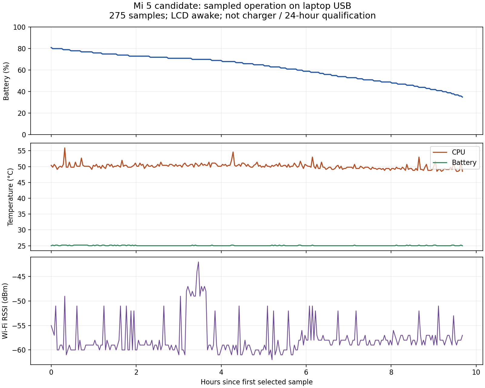

# Stable release acceptance — 31 October 2026

Status: **validation in progress; version remains `0.1.0-preview.1`**.
Do not replace elapsed hardware evidence with a version-number change.

Latest verified sequence, **1 November, 07:47 WIB**: five consecutive charger
reboots passed on the replacement Wi-Fi network, following five passing USB
reboots. The original old-network charger sequence remains failed at attempt
five, with DHCP-stage failure observed. Paired qualification started at
**07:48 WIB** and has not completed its required duration. Fresh installation,
physical LCD checks and requested throughput remain separate. See
[the new charger results](#replacement-network-charger-boots-and-qualification-2026-11-01).

Additional read-only audit, **1 November**: no warning/error records were found
in the captured qualification runtime, but boot diagnostics remain open.
These include a clock WARN, repeated journal unclean-open messages despite
successful journal consistency checks, and a confirmed backup GPT header CRC
mismatch on `sdf`. No partition table was modified. See the
[kernel, journal and GPT findings](#kernel-journal-and-gpt-findings-2026-11-01).

Earlier observation at **20:19 WIB on 31 October**: the installed candidate had remained on
the same boot for approximately 10 hours 52 minutes. Wi-Fi SSH and the HTTP
workload were reachable, required services were active and ext4 reported zero
errors. The phone still reported laptop USB SDP, with battery capacity 27%.
This is not a completed charger qualification. Earlier observations below
describe their own test stages; this is not the latest power-source reading.

The first 24-hour attempt **failed its network gate**. The application and
filesystem checks below passed separately; they do not override that failure.

## Fresh candidate installation, 1 November, 21:05 WIB

A verified full userdata backup and matched boot recovery set were saved before
an explicitly authorized clean install. The separately authorized GPT repair
changed only the four incorrect backup-header CRC bytes; full-LUN readback
matched the expected repaired hash. The new production boot has no alternate
GPT warning. Backup restoration of the entire installed system remains untested.

The new `7.0.0-gemini-lk-clockrtc #2` kernel booted the generic image and
completed Armbian first login. The `wkp` account was created with sudo access,
the root password was set securely, and English UTF-8 with Asia/Jakarta was
configured. Root USB SSH and Wi-Fi SSH were verified using the new host key
obtained from the physical USB console. Root ext4 expanded to the existing
25 GiB userdata partition, kernel taint was zero, and systemd reported no failed
units. Network time synchronized after Wi-Fi provisioning. These are initial
checks, not completion of the stability qualification.

Two Debian fastboot 34.0.5 attempts stalled during sparse downloads. Both failures
are retained. A separately reviewed installer harness with live progress,
256 MiB transfers and Google fastboot 37.0.1 completed all 14 userdata transfers,
the boot write and reboot. The project installer now adopts live progress,
that cap and a minimum tested client version; its 21 preflight/failure tests
pass. Rebuilt package validation and additional production boot/workload tests
remain pending at this checkpoint. The original packaged installer must not be
reported as having passed this hardware install unchanged.

ModemManager on the laptop was observed probing the phone's serial console.
A local udev rule now excludes only this gadget's identifiers and product
strings. Whether those probes caused the skipped root-password prompt is
unproven; the installed root password was explicitly reset before enabling
Wi-Fi. Other cellular modem devices were left untouched.

The prior soak ended during the operator's charger-to-USB transition. Its
failed charger observation and host coverage gap remain recorded. Qualification
for this newly installed kernel starts separately. The testing cutoff timer
was reinstalled for 23:58 WIB; the phone will not be shut down. The 24-hour
criterion and 10 MB/s Wi-Fi target remain unmet.

## Charger and startup fixes

Moving from laptop USB to the charger retained the same Linux boot and Wi-Fi
connection. The supply reports DCP; battery rose from 23% to 30% during the
initial observations, with measured battery current around −1.2 A and battery
temperature around 25 C. Root remained writable and ext4's error counter was 0.

The preceding boot's network journal established the startup timeout sequence:

- NetworkManager wait-online started at about 11 seconds of uptime.
- Wi-Fi's first DHCP transaction began around 19 seconds, then failed at 64
  seconds after its 45-second timeout.
- Normal autoconnection retried and obtained an address around 74 seconds.
- The old wait-online deadline had already expired around 71 seconds.

The board drop-in now permits 120 seconds for `nm-online`, with a separate
130-second systemd deadline. It retains the normal startup check and failure
semantics. Re-running that check on the connected phone passed, with no failed
units. This accommodates a retry; it does not establish reliable reception or
remove the need to test future boots. Observed Wi-Fi signal was about −82 dBm.

See NetworkManager's [startup wait documentation](https://networkmanager.dev/docs/api/latest/NetworkManager-wait-online.service.html)
and [nm-online timeout documentation](https://networkmanager.dev/docs/api/latest/nm-online.html).

## Application and storage checks

A temporary HTTP workload uses the locally cached ARM64 Alpine image, with
64 MiB memory, 0.25 CPU and 32-process limits. It runs as an unprivileged user,
has a read-only container root, drops capabilities and uses a separate writable
data directory. It increments persistent state every ten seconds and serves
JSON on port 18080. This is an acceptance fixture, not a production database or
a CPU stress test.

Alpine's default BusyBox lacks `httpd`; the fixture binds the already validated
static Debian ARM64 BusyBox explicitly and checks that applet before starting.
An initial fixture startup failed for this missing applet and was corrected
before acceptance recording. Its startup failures are not counted as device
soak results.

The application was stopped before copying state. The snapshot was restored
into a separate data directory and container. The restored HTTP counter equaled
the snapshot value, 17; the original application also resumed from that value.
The restore container was removed, and the main test container was active at
the last successful inspection before the later Power reset. Independent HTTP
access from the laptop passed then; post-reset application state is unverified.

LCD sleep and wake commands passed on the pre-reset boot. With the LCD asleep,
backlight brightness was 0 while HTTP, Docker, SSH, root writes and the same
boot ID remained healthy. Physical Power/Home operation after reboot remains
a separate test. Automatic timeout was disabled at this earlier stage; the
later timeout test and current setting are recorded below.

## Soak recorder

[stability-soak.py](../scripts/stability-soak.py) records actual root writes,
ext4 errors, service states, charger type, capacity, temperatures, Wi-Fi IPv4,
container OOM/restarts and HTTP counter progress. Elapsed time uses uptime so
the initial incorrect RTC cannot make a short run appear to last 24 hours.
A reboot, observation gap longer than three minutes, missing metrics or a
recorded service/storage/network/power fault prevents a passing result. A
declining battery trend on DCP and an application counter that stops advancing
also prevent success. Logs remain private and bounded; a terminal result stops
the temporary recording timer.

[monitor-soak.py](../scripts/monitor-soak.py) independently requests both SSH
and HTTP over Wi-Fi from the laptop. Local service health alone cannot satisfy
this network check. SSH uses strict pinned host keys; credentials are supplied
through a private local askpass helper and never written into reports.

The short recorder smoke test is explicitly separate from the required
24-hour run. A passing short run must never be used as 24-hour evidence.

## First long-run attempt: network failure

The device run started at 06:47 WIB. At roughly six minutes, its local recorder
observed unavailable Wi-Fi IPv4 while the root write probe, ext4 error counter,
required services and local HTTP application remained healthy. Independent
SSH/HTTP requests also failed. Further intermittent outages followed.

The phone later returned automatically on the same boot ID, with writable root
and battery 45%, charging at about 1 A. This was network recovery, not a reboot
or evidence of another storage failure. The local acceptance timer stopped on
the failed observation. The independent attempt was closed as failed, and its
raw samples were retained for diagnosis.

Detailed NetworkManager logs show a 120-second DHCP lease expiring, a further
45-second acquisition timeout, then local disassociation and reconnection.
The driver's key-removal timeout followed that disassociation. The ordering
does not establish key-install timeout as the original trigger.

A bounded private capture on the phone records DHCP message types and lease
timing. Successful observed renewals contain a matching client REQUEST and
server ACK, with approximately 54–60 seconds until the next renewal. The cause
of the missing renewals remains under investigation. Packet summaries and
full diagnostic history are private and are not release payloads.

The user moved the phone nearer the router/access point. A new signal
measurement has not yet been obtained because connectivity was unavailable
after that move. The user requested waiting for automatic reconnection before
USB intervention; no reboot or profile change was made during that wait.

The user subsequently reported holding Power to reboot and confirmed that the
LCD returned to a Linux login. Network access still did not return during the
following observations. This is a user-initiated hardware reset, not a passing
automatic reboot test. The new boot ID, filesystem check and radio state have
not been read. USB inspection without another reset was requested; a bounded
local watcher will collect evidence when USB SSH becomes available.

### USB inspection and controlled radio test

USB inspection subsequently verified a new boot, successful root filesystem
check, writable root, ext4 error count 0 and the Docker counter application.
Wi-Fi and its PCIe driver were present, with no rfkill block. Three bounded
recovery attempts had failed with `ssid-not-found`. An explicit scan found the
production AP and normal autoconnection returned on the same boot. The observed
signal was still approximately −90 dBm. This is a different immediate failure
from the earlier DHCP expiry; neither observation alone proves all outages
have the same cause.

A protected laptop AP then provided an isolated static-address radio test.
HTTP worked on channel 1. The AP was turned off for 35 seconds; the phone
became disconnected and external HTTP failed. When the AP returned on channel
11, normal autoconnection restored HTTP in approximately 8.18 seconds, with
the same boot ID and advancing application counter. The temporary client
profile was removed and the production profile/recovery timer restored.
This test excludes DHCP and does not satisfy the full production-network soak.

The first fixture setup could not load a keyfile outside NetworkManager's
runtime connection directory; it was corrected before the successful test.
A separate host configuration error briefly activated shared mode and enabled
IP forwarding. The AP was deactivated and forwarding was explicitly restored
to its original value, 0. The laptop's original Ethernet default route was
verified unchanged. No AP remains active.

### Board-data mismatch found

The installed generic QCA6174 board file differs from `image/bdwlan30.bin` in
this phone's original modem firmware. Both are 8,124 bytes with valid internal
checksums. The factory file's SHA-256 is pinned in
[the board profile](../config/gemini-wifi-board.json).

With the factory data supplied through the driver's device-specific board
filename, observed production-AP signal improved from approximately −90 dBm
to −59/−60 dBm. Reverting to generic data and reprobling the driver failed to
connect within 30 seconds; the cleanup restored factory data and connectivity
returned at approximately −51 dBm. Kernel board CRC changed from `ed5f849a`
to the expected `308ae9a4`, confirming which data was loaded. The firmware
executable and kernel were unchanged. This strongly supports a board-data
problem; it does not establish 24-hour reliability.

Three subsequent 8 MiB integrity-checked HTTP transfers measured approximately
3.12–4.11 MB/s. The 10 MB/s target remains unmet. The current production link
negotiates 72.2 Mbit/s on 2.4 GHz with one stream, so that negotiated PHY rate
itself is below 10 MB/s before protocol overhead. A faster link remains a
separate requirement.

The build now requires the verified board data in both initramfs and rootfs,
and rejects the previous generic-only boot image. A new package build and
cold-boot verification are in progress. See [board data preparation](wifi-board-data.md).

The completed seven-minute diagnostic captured eight renewal REQUESTs and eight
matching ACKs on the 120-second production lease. The exact rebuilt boot image
then passed a normal USB reboot: early board CRC `308ae9a4`, successful fsck,
ext4 errors 0, root writes, regular-user Wi-Fi SSH, external HTTP and retained
application counter. The installed private rootfs was retained; this was not a
fresh generic-image installation or a cold power-on test.

### Shutdown splash delayed reboot

The first exact-candidate reboot took approximately 153 seconds to become fully
ready. The retained kernel console showed final shutdown waiting for
`plymouthd`; the preceding journal confirmed `plymouth-reboot.service` started.
Boot-time splash units had been masked, but shutdown splash units were still
enabled through vendor target links.

The board configuration now also masks `plymouth-reboot`, `plymouth-halt`,
`plymouth-poweroff` and `plymouth-kexec`. The same change was applied to the test
phone. The next normal reboot passed in approximately 62 seconds with Wi-Fi,
SSH, Docker, persistent state and clean root. No timeout was shortened and no
forced reboot was used. Further consecutive boots are being recorded.

Rootfs and archive checks now require those shutdown masks; the rootfs checker
has 41 checks. The boot image remains byte-identical to the candidate already
tested. Packages are being rebuilt for the final rootfs configuration.

The host assessor was corrected to distinguish unavailable measurements from
observed faults: a failed SSH probe is missing coverage, not proof of storage,
temperature or battery failure. The original evaluation and unmodified raw
samples are retained; reassessment still reports failure. The earlier bounded
network observation ended without verified recovery. The USB watcher completed
when the phone was connected; new short diagnostics are separate from a
qualifying 24-hour run.

## Build and test results

The generic rootfs and both release packages were rebuilt with the startup
deadline change. All 39 rootfs checks, both native init safety modes, 13
installer tests, 9 layout tests, 20 server tests and 10 acceptance-tool tests
passed. Both archive payloads and checksums passed full verification. The
generic image was not freshly installed on the phone in this session.

The Linux reboot helper also gained verified USB identity and a bounded
fastboot response check. Five regression tests cover serial selection and the
misleading `fastboot devices` result. This fixes detection; automatic software
entry into the bootloader remains unresolved.

An 8 MiB phone-to-laptop HTTP transfer passed its integrity check at about
2.56 MB/s. The requested 10 MB/s performance target was not met under those
conditions. This result does not describe throughput after the physical move.

An off-device copy of the consistent application backup was verified against
its recorded SHA-256 and snapshot counter. A bounded full package checksum
scan timed out; it must not be reported as a completed OS-wide integrity audit.

## Final candidate checks

Five consecutive normal USB reboots passed after the shutdown fix, with no
cable intervention or physical reset. Readiness times were approximately
62.38, 54.91, 53.44, 52.08 and 61.10 seconds. Each verified a new boot ID, exact
boot image hash, early factory board CRC, successful fsck, actual root write,
ext4 errors 0, required services, ordinary-user Wi-Fi SSH, external HTTP and
retained application state. Physical Power/Home checks remain unverified.

The corrected generic image defaults to a stable local Wi-Fi MAC. The board's
permanent address is a shared template, so preserving it is insufficient for
independent installations. The existing test phone's explicit original MAC
remains unchanged. Fresh profiles without an explicit MAC were tested on an
isolated AP; their generated address remained the same across profile
recreation and AP outage/return.

The first DHCP outage recorder exited on the expected `ENETDOWN` event. Its raw
failure is retained. After fixing that observer, a repeated six-minute steady
test had advancing HTTP state and seven matching DHCP REQUEST/ACK transactions
on 120-second leases. The capture continued through the outage and ended
cleanly, including an ACK after the AP returned. Independent HTTP returned
automatically in approximately 3.88 seconds on the same boot and MAC.

The test script still exited with a cleanup error: restoring the production
profile exceeded its 35-second command wait. NetworkManager continued the
activation and returned to the production network automatically. A separate
follow-up verified Wi-Fi SSH/HTTP, normal services, no failed units, and no lab
rollback timers. Host IP forwarding was restored to 0 and its original default
route retained. The failed script result is preserved alongside that follow-up;
it has not been rewritten as an unqualified passing run.

The final candidate build passed 42 rootfs checks, both init safety modes, 31
Python boot/installer/layout/firmware tests, 20 server tests, 12 acceptance-tool
tests, ten isolated IPv4/IPv6 route cases, sparse roundtrip and full archive
verification. Acceptance write probes use separate temporary files so concurrent
local/remote probes cannot overwrite or remove each other's probe. Build
provenance matches the current inputs.

The 24-hour recorder has been updated and prepared **disabled**. A new run
requires a real DCP source and healthy device preflight. Prior failed runs are
retained; no new 24-hour run has started while the phone remains on laptop USB.

## Retrospective USB operation and automatic LCD timeout

A later read of the same boot's retained health samples covered approximately
9 hours 41 minutes after the controlled AP tests. All 275 selected samples
showed Wi-Fi connected and the five sampled main services active. The median
sample interval was 129.02 seconds, with a maximum gap of 130.64 seconds.
Sampled CPU temperature peaked at 55.9°C and battery temperature at 25.2°C;
Wi-Fi RSSI ranged from −62 to −42 dBm. The NetworkManager journal in that
post-lab window contained 639 lease acquisitions/renewals and no matching
failed-state, lost-lease, SSID-not-found or IP-configuration failure events.
These event filters and periodic samples do not prove absence of every short
interruption or provide independent continuous HTTP coverage.

The source remained laptop USB SDP and the LCD was awake. Battery capacity
fell from 81% to 35% across the selected samples. This evidence therefore
cannot pass the DCP charging or formal 24-hour gates. A separate current probe
also verified an actual root write with fsync, ext4 errors 0, no failed units,
and the application container running with no OOM or restarts.

The [sanitized samples](measurements/2026-10-31/usb-health.csv) and
[bounded summary](measurements/2026-10-31/usb-retrospective-summary.json)
contain no network names, addresses, credentials or device identifiers.

An automatic LCD timeout test then observed brightness reaching 0 after a
300-second idle interval. Console journal timestamps place the asleep period
at 12:50:24.867–12:51:03.417 UTC. Four independent HTTP samples fell inside
that interval; all succeeded and the application counter advanced. The full
six-minute HTTP observation had 36 successful samples. Remote wake restored
the LCD without changing the boot ID. The observer finished successfully and
its temporary restoration timer was stopped.

After restoring the original configuration to complete that test, the phone
was deliberately configured with the generic image's normal five-minute
timeout and 20% brightness. The LCD was put to sleep to reduce laptop-USB
power demand; networking and services remained active. Remote wake is
available with `sudo mi5-config display wake`. Physical short Power and Home
behavior after reboot remains unverified.

A follow-up with the LCD still asleep verified Wi-Fi SSH, advancing HTTP
state, an actual root write, no failed units, no container OOM/restarts and
ext4 errors 0. Capacity remained 27%; instantaneous battery current was about
−7 mA. One instantaneous reading does not establish a charging trend.

## Fresh-install preflight and Windows test preparation

A read-only live-device preflight confirmed that the installed aboot hash
matches the supported layout and the original backup proof. Recovery's current
hash matches the off-device backup, whose bytes were rehashed against its
manifest together with the original boot backup. The installed boot prefix
also matches the candidate payload exactly.

A separate full 64 MiB backup of the currently installed candidate boot
partition was then copied off the phone and verified against its source
SHA-256. Its temporary RAM copy was removed after verification. This backup
preserves the current boot partition; it does not include Linux userdata.

The installer payload checks passed against the current image files. The
15,667,200-byte boot image fits the 67,108,864-byte boot partition; the expanded
4,718,592,000-byte rootfs fits the 26,856,108,032-byte userdata partition. These
are preflight results only. No userdata flashing, formatting or fresh install
was performed; the running OS continues its normal filesystem activity.
A consistent backup of the current Linux userdata and explicit authorization
to erase it are still required before running the destructive install.

An isolated Windows VM test environment is being prepared. KVM, the Q35 device
topology, UEFI flash configuration and emulated TPM initialization passed a
bounded device-startup check. That check did not boot Windows or attach the
phone. The official Windows 11 Enterprise evaluation ISO finished downloading:
its 8,225,329,152-byte size and [Microsoft SHA-256](https://support.microsoft.com/en-us/servicing/os/windows/docs/2026/09/verify-the-authenticity-of-a-windows-11-enterprise-evaluation-iso-file)
matched before setup ran. At the subsequent observation, Windows Setup showed
21% complete. The VM uses a separate qcow2 disk,
resource limits and an isolated guest network. Phone USB passthrough is a
later step after Windows setup, not part of disk installation.

The physical RNDIS gadget was separately queried with read-only endpoint-zero
requests. It returned `MSFT100`, vendor code `0xcd` and a 40-byte extended
compatible-ID descriptor identifying `RNDIS` / `5162001` on interface 0.
The expected four interfaces, composite device class and 500 mA maximum power
descriptor were present. No interface was claimed, reset or detached. The
[sanitized descriptor result](measurements/2026-10-31/usb-rndis-descriptors.json)
records this narrower hardware check; it is not a Windows driver test.

At 20:49 WIB, the phone was still on laptop USB SDP, with the LCD asleep and
capacity down to 18%. Required services, root writes and HTTP remained healthy,
with ext4 errors 0 and no container OOM/restarts. Further tests adding device
load are held pending charging. An instantaneous current near zero does not
override the observed capacity decline.

At that preparation stage no Windows result was claimed. A real Windows kernel with phone USB
passthrough would provide scoped driver/DHCP/SSH evidence; it would still need
to be identified as a VM test with its exact Windows version. It would not
prove native-PC or Windows 10 behavior.

## USB mode revision correction

Review against Microsoft's [OS-descriptor cache documentation](https://learn.microsoft.com/en-us/windows-hardware/drivers/usbcon/microsoft-defined-usb-descriptors)
found that both USB modes used the same vendor/product/revision tuple, despite
RNDIS providing a Microsoft OS string and NCM not providing it. Windows can
retain a negative query result for that tuple. A different serial suffix per
mode does not separate that cache. This establishes a configuration defect;
the resulting mode-order failure has not yet been reproduced on Windows.

The gadget now uses revision `0x0102` for RNDIS and `0x0103` for NCM. Both avoid
the previous shared `0x0101` cache. Two regression tests cover mode-order cache
reuse and legacy-cache reuse; all 22 server tests passed. The generic rootfs
passed 43 checks, including the new cache-separation check. Rootfs images,
sparse roundtrip and both release archives were rebuilt and verified against
the current source. The production boot image remains byte-identical.

The initial phone observation still used revision `0x0101`. After almost two
hours of stable 18% idle capacity with the LCD asleep, a bounded, lightweight
update applied the corrected gadget without rebooting the OS. Root remained
healthy, Wi-Fi control and the application stayed available, and the descriptor
changed to `0x0102` with capacity still 18% immediately after application.

Live Linux checks then passed NCM `0x0103` with `cdc_ncm` and RNDIS `0x0102`
with `rndis_host`. Both modes passed ordinary-user USB SSH, USB HTTP and
descriptor/DHCP configuration checks. Wi-Fi HTTP remained available, the
application counter advanced and the laptop retained its wired default route.
The same OS boot remained active throughout. RNDIS was restored, and the
independent restoration timer was stopped. A later passive reading was 17%,
approximately 3.738 V, with the 500 mA SDP input limit. This short maintenance
test does not change the charger, reboot or 24-hour acceptance requirements.

The five earlier USB boots remain
valid evidence for the kernel/shutdown configuration with the previous gadget,
not proof of the newly corrected USB revision. Windows mode checks subsequently
passed as described below; the new OS boot sequence remains required. No stable
label or publication has been applied.

At 21:32 WIB, a passive power snapshot still reported 18%, USB SDP and a 500 mA
input limit, on the same boot. The low instantaneous charging current and
unchanged capacity in that interval do not establish charger qualification.

## Windows 11 USB validation (2026-11-01)

The real Mi 5 composite USB device was passed through to Windows 11 Enterprise
Evaluation, version 10.0.26300.9457, running under QEMU/KVM. The installed guest
reported TPM present/ready/enabled and Secure Boot enabled. Windows displayed
an expired evaluation-license notice; this temporary test guest is not a
licensed production installation. Its observed shutdown during setup was
followed by another boot of the same disk. No phone partition was exposed as a
Windows installation disk.

The corrected gadget was tested in NCM-first, then RNDIS order within the same
Windows guest. Neither custom INF files nor driver-policy changes were used.
QEMU forwarded the phone's Microsoft descriptors and remote-wakeup flag.

| Check | NCM | RNDIS |
| --- | --- | --- |
| Actual device revision | `0x0103` | `0x0102` |
| Microsoft network driver | UsbNcm Host Device, 10.0.26100.9444, signed | Remote NDIS Compatible Device, 10.0.26100.1, signed |
| Windows OS-descriptor cache bytes | `00 00` | `01 cd` |
| DHCP from the phone | Passed | Passed |
| Ordinary-user SSH and forced PTY, exit code 0 | Passed | Passed |
| HTTP application state | Passed, counter 6649 | Passed, counter 6664 |
| No USB default route or IPv4 DNS | Passed | Passed |
| Existing controlled default route retained | Passed | Passed |
| ACM serial login prompt | COM3 | COM4 |

The [sanitized result](measurements/2026-11-01/windows-usb-validation.json)
records the tested drivers, mode order, cache bytes and cleanup checks without
phone identities, network names, credentials or SSH output.

Official Python 3.15.2 and fastboot 37.0.1 also executed successfully in the
guest. A Windows verifier checked the final Fastboot archive's checksum and
ran the shipped installer's `validate_payloads()`: 15,667,200 boot bytes
and 4,718,592,000 expanded rootfs bytes. Its [native result](measurements/2026-11-01/windows-package-validation.json)
was copied from Windows through the VM's control serial port after the
automation channel stopped responding. No installer entry point, flash
operation or fresh-image onboarding was run.

The guest's isolated Ethernet initially had no default route. A temporary
route through its virtual gateway was explicitly added before phone attachment
to test route preservation. This is a controlled routing check, not a Windows
Internet-connectivity test. QEMU's [`restrict=on` network](https://www.qemu.org/docs/master/system/qemu-manpage.html)
remained enabled. SSH pinned the established phone host key and used a temporary
key restricted to the USB subnet and the `id` command. The serial test sent
Enter only and observed the Linux login prompt; it did not log into the shell.

Initial harness failures are retained privately. An empty DNS list was first
miscounted as a null array entry, then independently confirmed empty. PowerShell
process waiting/result handling was corrected before the final SSH checks;
the passing results require both actual output and exit code 0.

After testing, the phone was detached from QEMU, its USB device-node ACL was
restored, and Linux again bound the RNDIS adapter. The temporary SSH authorization
and guest/host private keys were removed. A subsequent USB SSH health check
verified the same Linux boot, actual filesystem writes, ext4 errors 0, all six
required services active, no failed units, working Wi-Fi/application and an
asleep LCD. Capacity was 16%, approximately 3.736 V, on laptop USB SDP.

These results cover this Windows 11 kernel with a physical USB device through
QEMU. Native Windows PCs, Windows 10, charger operation and fresh-image
installation remain separate evidence requirements. The project remains a
preview.

## Charger reboot sequence (2026-11-01)

After the user moved the phone to a charger, Wi-Fi SSH remained available on
the same boot. The actual supply reported DCP, with battery current initially
about −1.57 A and temperature 24.7°C. Capacity rose from 19% to 30% before
reboot testing. This establishes short charging progress, not a 24-hour pass.

Five normal `systemctl reboot` attempts were scheduled sequentially, with a
fresh health and DCP/battery preflight before each attempt. The harness stopped
at the first failed attempt; it did not request a forced reset.

| Attempt | Result | Time to verified SSH/HTTP readiness | Battery at verification |
| --- | --- | --- | --- |
| 1 | Passed | 148.94 seconds | 33% |
| 2 | Passed | 68.41 seconds | 34% |
| 3 | Passed | 58.17 seconds | 35% |
| 4 | Passed | 77.58 seconds | 37% |
| 5 | Failed reachability gate | Not verified within 180 seconds | Not observed |

Each passing attempt verified a new boot ID, exact candidate boot/gadget
identity, early factory Wi-Fi board CRC, successful fsck, a real root write,
ext4 errors 0, active services, ordinary-user Wi-Fi SSH, external HTTP and
retained application state. Charging resumed after each passing boot, with
observed battery current between approximately −1.09 and −1.28 A.

The fifth attempt remained unreachable at follow-up. A subsequent bounded
ten-minute observer ended without Wi-Fi or USB access. Local ARP discovery
also did not find the phone's expected MAC. This does not yet
distinguish a Linux boot failure from Wi-Fi/DHCP failure. Its raw failure is
retained, USB diagnostic access without another reset was requested, and the
new formal 24-hour test remains unstarted. The sequence therefore does not
pass the required five-consecutive-boot gate. The [sanitized results](measurements/2026-11-01/charger-reboots.json)
preserve the failed attempt alongside the four passing attempts.

The user also confirmed that only 2.4 GHz Wi-Fi is available. A read-only radio
query showed one spatial stream, HT MCS 0–7 and HT40 support; the actual link
used a 20 MHz channel at 72.2 Mbit/s. Router HT40 support still needs to be
identified and tested. The requested 10 MB/s target remains unmet.

## USB diagnosis and network change (2026-11-01)

USB was subsequently connected while the failed fifth boot was still running.
Its boot ID and uptime establish continuity with that attempt. The kernel
initialized its random generator at about six seconds, and Linux reached its
normal target after approximately 136 seconds. NetworkManager's online wait
took 120 seconds and failed. The Wi-Fi journal showed repeated successful WPA
handshakes followed by 45-second DHCP timeouts and `ip-config-unavailable`.
This identifies the failing stage; it does not establish whether the DHCP
server, radio packet delivery or client handling caused the missing lease.

The user supplied another SSID and credentials. Matching the advertised SSID's
letter case allowed activation; DHCP then assigned an address and Wi-Fi became
the default route. Ordinary-user SSH and application HTTP from the laptop,
plus HTTPS from the phone to the Debian mirror, succeeded on the same boot.
The profile is saved for autoconnect, and the opt-in recovery configuration now
selects it. Autoconnect on the old profile was disabled; its saved configuration
remains available for manual recovery. The selected profile's ownership and
0600 permissions were verified on the phone. After network recovery, retrying the previously failed online-wait
service succeeded; the original failure logs remain retained.

The follow-up verified real root writes, ext4 errors 0, active required
services, no failed units and retained application state. Capacity was 66%
on laptop USB SDP. The new network's signal was only about −78 dBm, with
reported receive/transmit link rates 7.2/13.0 Mbit/s; these are link rates,
not a throughput benchmark. The 10 MB/s target remains unmet. A bounded
six-minute observation passed with 13 successful network SSH/HTTP samples and
an advancing application counter. The NetworkManager journal recorded 12
matching new-lease events, with intervals of approximately 53–59 seconds.
These are journal events, not packet-level DHCP ACK capture. This short test
on laptop USB remains separate from formal 24-hour charger qualification.
The [sanitized follow-up](measurements/2026-11-01/wifi-switch-validation.json)
contains no SSIDs, addresses, device IDs or credentials.

Changing networks does not turn the fifth timed-out attempt into a passing
boot test. The subsequent current-revision USB sequence below passed. A new
charger-only boot sequence, physical LCD checks, fresh-image onboarding and
full 24-hour evidence on the selected network remain required.

## Current-revision USB boots (2026-11-01)

Five consecutive normal USB reboots passed with gadget revision `0x0102` and
the selected replacement Wi-Fi profile. Readiness was verified after 53.64,
52.05, 63.90, 53.50 and 53.49 seconds. Each attempt verified a new boot ID,
exact boot/gadget identity, early factory board data, successful fsck, an
actual root write, ext4 errors 0, required services, Wi-Fi profile identity,
ordinary-user network SSH, external HTTP and retained application state.

The harness read the actual Wi-Fi IPv4 address through USB before testing
network access. The address stayed the same across all five attempts. The
laptop's IPv4 and IPv6 default-route sets were unchanged. An intermediate
startup probe during attempt three saw Wi-Fi still disconnected; readiness
was then verified at 63.90 seconds within the 180-second gate. Raw probes and
the earlier failed charger result remain retained.

The [sanitized sequence result](measurements/2026-11-01/usb-reboots-current-revision.json)
records the five passing attempts. This establishes the corrected USB boot
sequence on the installed private userspace. Physical Power/Home checks,
fresh generic-image onboarding and charger qualification remain separate.
A consistent offline userdata backup is being prepared before any fresh-install
erase approval; no userdata erase or fresh install was performed.

## Replacement-network charger preflight (2026-11-01)

A separate five-boot charger harness now selects the replacement network and
retains the earlier failed sequence. Its default mode collects preflight data
without requesting a reboot. Before each execution attempt it requires an
actual DCP source, at least 30% battery, safe temperatures, the selected saved
profile, healthy services/storage, the corrected gadget hash and no active
qualification. Post-boot checks also require resumed charging or a full battery.

The native preflight observed the selected profile active, battery 72%, battery
temperature 25.0°C, CPU temperature 46.9°C, ext4 errors 0, no failed services,
and a running application without OOM or restarts. The selected power source
was still laptop USB SDP, so the preflight reported `not_ready`; no reboot or
24-hour qualification was started. This is a readiness observation, not a
passing charger test. The harness initially uses the last verified Wi-Fi
address. If DHCP changes it while network access is absent, stop and inspect
address assignment before interpreting a reachability timeout as a Linux boot
failure.

## Replacement-network application throughput (2026-11-01)

Three sequential 8 MiB downloads from the existing Docker HTTP workload to the
routed wired laptop completed with HTTP 200 and matching SHA-256 checksums.
Measured download speeds were 768,692, 733,373 and 607,514 bytes/s, or about
0.77, 0.73 and 0.61 MB/s in decimal units. All are below the requested
10,000,000 bytes/s. These are application-path measurements, not an isolated
radio-capacity test or an Internet speed test. The existing workload's CPU
quota and the routed path remain part of the measurement.

The phone reported −79 dBm, channel 11 at 2462 MHz, 20 MHz width, receive link
rate 7.2 Mbit/s and transmit link rate 19.5 Mbit/s. These observations do not
prove which component limited throughput. The temporary benchmark file was
removed after the test. Native follow-up verified the same Linux boot, healthy
services and application, no container OOM/restarts, ext4 errors 0, battery 72%,
battery temperature 25.0°C and CPU temperature 48.8°C. No qualification timer
was started and no reboot was requested. See the
[sanitized benchmark](measurements/2026-11-01/selected-wifi-throughput.json).

## Replacement-network charger boots and qualification (2026-11-01)

After the user moved the phone to its charger, native preflight confirmed DCP,
battery 73%, approximately 1.24 A charging current, healthy services/storage,
the selected saved profile and no active qualification. Five consecutive normal
charger-only reboots then passed, with readiness at 62.02, 60.89, 49.09, 53.53
and 49.04 seconds. No cable change or forced reset was used during the sequence.

Each attempt verified a new boot ID, exact boot/gadget identity, early factory
board data, successful fsck and root write, ext4 errors 0, active services,
selected-profile identity, ordinary-user network SSH, external HTTP, retained
application state and resumed DCP charging. Capacity reached 76%, and post-boot
charging current was approximately 0.97–1.06 A. The laptop's default routes
were unchanged. The [sanitized sequence](measurements/2026-11-01/charger-reboots-selected-network.json)
records the new five passing attempts; the old-network 4/5 failure remains
preserved separately. This covers normal reboots, not a cold start, physical
Power/Home behavior or a fresh generic-rootfs installation.

Paired qualification started at 07:48 WIB with native recording for 24.1 hours
and an independent laptop SSH/HTTP monitor for 24 hours. The six-minute native
margin accommodates monitor startup. Earliest native completion is
**2 November, 07:54 WIB**. The native timer and host process were both verified
live; initial reports were `running` without failures. The native follow-up
observed battery 77%, approximately 1.06 A charging current, battery temperature
24.7°C and CPU temperature 51.7°C. The laptop sleep inhibitor was checked before
starting. See the [startup snapshot](measurements/2026-11-01/paired-qualification-start.json).
During the ongoing run, laptop mains power was verified online and the
independent monitor's actual process was listed with an active sleep-blocking
inhibitor.
A bounded host sleep inhibitor also covers the remaining lifetime of the
original result collector, including the six-minute native recording margin
after independent monitoring ends. Its active lock was verified against the
actual process. It releases when that collector ends and has a maximum runtime
cap; the original monitor/collector PIDs were retained without a test restart.

These startup observations are not a 24-hour pass. Keep the existing run intact,
collect both final reports, and investigate any failure without restarting the
test to discard it. No further reboot or cable change is planned during this run.
A separate read-only host collector now saves native result snapshots every
five minutes and will retain the final paired result after both recorders end.
It checks full duration, sample coverage and matching test boot identity before
reporting a paired pass; it never starts, stops or restarts either test. Its
first real checkpoint found both reports running without failures. This
collection mechanism does not establish a completed qualification by itself.

An early LCD observation on the final charger boot found the display asleep
with backlight brightness 0. During about 137 seconds of observation, all 68 local
application checks succeeded, together with two independent authenticated
SSH/HTTP checks inside the observed sleep interval. The observer did not
receive any physical Power/Home events, so this verifies service availability
with the LCD asleep, not physical button sleep/wake. The full qualification
remained running. See the [scoped LCD observation](measurements/2026-11-01/charger-lcd-sleep-observation.json).
The bounded observer subsequently ended normally after ten minutes. Across
that completed interval, all 294 local application checks and ten independent
authenticated SSH/HTTP checks passed while the backlight remained at 0. The
same boot was retained, and no Power/Home events were received. Its
[completed observation](measurements/2026-11-01/charger-lcd-sleep-10min.json)
therefore establishes availability with the LCD asleep on the charger; physical
sleep/wake remains unverified. The observer exited without changing the console
configuration or interrupting the separate 24-hour run.

Read-only network context was added to the existing result reader during the
run, without restarting the qualification or collector. An initial current-boot
journal snapshot retained the earlier history; subsequent five-minute snapshots
use overlapping seven-minute windows. This preserves DHCP events and selected
profile/link observations for the final audit. Reader hashes before and after
this diagnostic extension are retained privately.

At about 33 minutes, the native report had 33 samples without failures and the
selected profile matched. NetworkManager recorded 36 new-lease journal events
since the test's first sample. Intervals were mostly 53–56 seconds, with one
97.88-second interval; the independent SSH/HTTP record had no failures at that
stage. Signal was −73 dBm. These are journal events, not packet-level DHCP ACK
capture, and the 24-hour test remains incomplete. See the
[partial DHCP observation](measurements/2026-11-01/charger-dhcp-initial-observation.json).

## First hour of independent qualification (2026-11-01)

The first 3602.06 seconds of independent monitoring contained 61 complete
SSH/HTTP samples without failures, on the same Linux boot. The largest sampling
gap was 62.37 seconds. Every sample confirmed DCP, writable root, ext4 errors 0,
active required services and a running application without OOM or restarts.
Its persistent counter advanced from 8942 to 9301.

Battery capacity rose from 77% to 99%, with battery temperature 24.7–25.0°C and
CPU temperature 47.8–52.7°C. The first-hour samples were retained as a separate
immutable snapshot, while the original 24-hour recording continued. See the
[sanitized first-hour result](measurements/2026-11-01/paired-qualification-first-hour.json).
This establishes the measured first hour; the complete paired duration, physical
Power/Home checks, fresh installation and requested throughput remain pending.

## Host restore transport review (2026-11-01)

While the qualification continued, local Fastboot/sparse tools version 34.0.5
were inspected and a 4 MiB synthetic image was used to check restore transport.
Normal conversion and expansion preserved its full SHA-256. Splitting under an
8 KiB transfer cap produced two fragments; applying all of them to a simulated
destination prefilled with nonzero bytes restored the fixture exactly. A
hole-skipping negative control left stale bytes and was detected. These host
checks support the planned normal raw-input path. See the
[scoped transport result](measurements/2026-11-01/restore-transport-host-checks.json)
and the reviewed [AOSP sparse reader](https://android.googlesource.com/platform/system/core/+/android14-release/libsparse/sparse_read.cpp).

A separate compact production boot payload was preserved from the already
verified full boot backup, with the expected boot-prefix hash. The full current
Linux userdata image is still pending. Its complete source/copy hash, read-only
filesystem check, device transfer limit and exact recovery commands must be
reviewed before requesting clean-install erase authorization. No phone partition
was written, no backup restore was attempted, and the existing qualification
was not restarted. These fixtures do not prove restoration of a full userdata
image by this Mi 5's bootloader.

## Fastboot download-limit preflight (2026-11-01)

The PC installer previously forced a 64 MiB transfer cap without checking the
device's reported download limit. The reviewed
[AOSP Fastboot implementation](https://android.googlesource.com/platform/system/core/+/android14-release/fastboot/fastboot.cpp)
uses the explicit cap when `-S` is supplied. The installer now queries and
validates `max-download-size` before either partition is written, chooses the
smaller of that limit and 64 MiB, and requires the boot payload to fit a raw
download. Missing, malformed or inadequate limits abort during preflight.

Nineteen installer tests and 37 boot/installation tests passed, including
smaller limits, unknown/invalid limits and raw-boot boundaries. The rebuilt
Fastboot ZIP passed complete archive validation, and its installer, backup
helper, boot-layout helper and firmware profile match the current source
byte-for-byte. The verifier now enforces those helper comparisons to reject
stale archive contents. The boot payload, rootfs image and TWRP archive stayed
unchanged; no phone configuration or partition was changed. See the
[offline installer validation](measurements/2026-11-01/installer-download-limit-validation.json)
for current artifact identity and scope.

The actual Mi 5 download-limit query and fresh package installation remain
pending physical Fastboot access after the existing qualification. The current
Android-bootloader firmware proof is retained. This is a PC installer fix and
does not establish a fresh generic-image installation or a completed 24-hour
test.

## Selected AP radio context (2026-11-01)

A read-only dump of the phone's existing scan cache found the associated AP
advertising `HT20`, primary channel 11, no secondary channel and 20 MHz station
width. The live interface also reported 20 MHz at 2462 MHz. Cached signal was
−78 dBm. Client PHY output advertised `HT20/HT40` and HT MCS indexes 0–7; the AP
advertised MCS indexes 0–15. These are current capability/operation observations,
not a determination of the handset's physical antenna-chain count.

The cached management information did not disclose a manufacturer or model.
No active scan or radio/configuration change was requested, and the existing
qualification continued. See the [sanitized radio context](measurements/2026-11-01/selected-ap-radio-context.json).
After qualification, the AP model and configuration are needed to assess a
wider-channel option and further performance tests. The requested 10 MB/s
target remains unmet; client-side width support alone does not establish a
faster working connection.

## Parallel Docker integration (2026-11-01)

Disposable ARM64 containers passed non-root execution with a read-only root,
all capabilities dropped, no new privileges and verified cgroup limits of
64 MiB memory, 0.25 CPU and 16 processes. User-defined bridge DNS and HTTP,
external DNS and HTTP, unprivileged volume writes, restart after a deliberate
test-container crash and retained data after container recreation all passed.
The original workload kept its container identity and restart count of zero;
the Linux boot, selected network and required services remained intact, with
zero ext4 errors. All disposable containers, networks and volumes were removed.
See the [Docker integration result](measurements/2026-11-01/parallel-docker-integration.json).

The first attempt failed because its HTTP client command supplied `wget -T`
to the injected Debian BusyBox, whose help does not advertise that option.
That invocation crashed both on the phone and in the host QEMU control.
Supported calls without `-T` succeeded; the corrected Docker tests used the
image-native client and passed. The failed attempt and diagnostic controls
remain retained. No candidate binary or phone configuration was changed.
The invalid-option crash mechanism has not been fully determined; see the
[fixture diagnosis](measurements/2026-11-01/busybox-wget-fixture-diagnosis.json).
This result does not establish a completed 24-hour qualification.

## Parallel SQLite recovery and backup (2026-11-01)

A disposable SQLite WAL database running as the ordinary user acknowledged
128 transactions containing 8 MiB of committed payload. The test killed only
its own writer process after a subsequent transaction had made uncommitted
changes. All acknowledged rows and payload digests survived; the uncommitted
insert was absent, the update rolled back and `integrity_check` returned `ok`.

A separately closed, standalone backup was copied to the laptop and verified
by size and SHA-256. Both the transferred database and a separate restored
database passed integrity and all 128 row checks. The phone fixture was then
removed; the verified host backup remains retained. See the
[SQLite recovery result](measurements/2026-11-01/parallel-sqlite-recovery.json).
This checks writer-process crash recovery and application-level backup/restore.
It does not simulate power loss or replace the pending full offline userdata
backup and fresh-install verification. The original qualification continued
through these tests without a reboot or workload restart.

## First four hours and DHCP review (2026-11-01)

The retained four-hour window contains 241 successful independent SSH/HTTP
samples, spanning 14,402.30 seconds of device uptime on one boot. The largest
gap between device samples was 65.59 seconds. The main application had no
restarts or OOM events, ext4 errors stayed zero and its counter advanced from
8942 to 10379. Battery capacity rose from 77% to 99%; sampled battery
temperature was 24.7–25.0°C and CPU temperature was 46.9–55.9°C.

Overlapping journal query windows covered that sample interval. After
deduplication, the filtered NetworkManager journal contained 262 new-lease
events and no other messages matching `dhcp4 (wlan0)`. Inter-event spacing was
52.861–100.995 seconds, with median 54.103 seconds. Frequent lease events alone
do not establish connection loss; the independent samples all succeeded.
These are journal observations, not packet-level DHCP acknowledgements, and
outages shorter than the sampling interval cannot be excluded. The
[four-hour evidence](measurements/2026-11-01/paired-qualification-first-four-hours.json)
is an interim result while both original recorders continue; it does not close
the 24-hour or other release gates.

## Interim resource history and service baseline (2026-11-01)

The existing bounded health history contained 145 samples from the current
qualification boot, spanning 17,621.29 seconds. Available memory ranged from
2,271,928 to 2,365,216 KiB, with zero sampled swap use and zero kernel OOM kills
on this boot. Root free space decreased by 708,608 bytes between the first and
last health samples. The first and last ten-sample median available memory
values were 2,344,456 and 2,314,666 KiB; available-memory changes alone do not
identify a leak or its cause.

A read-only snapshot recorded resident memory, threads, open file descriptors
and cgroup memory for NetworkManager, SSH, Docker, containerd and the console.
All five were active and their cgroups recorded no OOM kills. This establishes
a service baseline for comparison at the end of the existing qualification;
there is no historical per-service series proving absence of resource growth.
See the [resource baseline](measurements/2026-11-01/paired-resource-baseline.json).
No service, phone or original recorder was restarted.

## Kernel, journal and GPT findings (2026-11-01)

A read-only kernel journal snapshot contained 208 records after qualification
started, from uptime 73.06 through 19,715.49 seconds. All were informational;
no warning/error records appeared in that captured runtime window. The earlier
boot contained 59 warning and 18 error-priority records, including an
`fd_ahb_clk` unused-clock warning with a call trace, UFS clock-gating messages,
driver-probe diagnostics and a journal unclean-open message. Current kernel
taint was 512. These boot findings have not all been explained or corrected;
successful sampled service operation does not make their disposition complete.
The Wi-Fi board lookup error was followed by API 1 loading with the expected
board CRC, which is retained in the private boot context.

`journalctl --verify` returned success for all 17 examined journal files,
including the renamed files. The previous normal boot also recorded an
unclean-open message. Current persistent and runtime journal header states
were respectively 0 and 1, corresponding to offline and online in the
[systemd 252 format definitions](https://github.com/systemd/systemd/blob/v252/src/libsystemd/sd-journal/journal-def.h).
The installed Armbian ramlog script flushes and relinquishes persistent
journaling; the latter operation switches subsequent logging to RAM, as
documented by [journalctl](https://www.freedesktop.org/software/systemd/man/261/journalctl.html).
That context does not yet establish the cause of the repeated unclean-open
message. No journal was deleted, repaired or rotated by this audit.

Read-only GPT header and entry-array CRC checks found valid primary tables on
all six UFS LUNs. Both copies were valid on `sda` through `sde`, including the
userdata and boot devices. The backup header CRC on `sdf` was invalid although
its entry-array CRC and primary table were valid. A separate util-linux parse
of captured metadata, using the actual 4096-byte logical sectors, confirmed
that its backup GPT was corrupt and its primary was usable. An initial
file-default 512-byte-sector parse was inconclusive and remains retained.

The first six and last five logical sectors of each LUN were copied off-device
and their hashes verified: 12 metadata regions in total. These are not complete
partition or userdata backups. The sparse host inspection fixture contains
only GPT metadata and must never be flashed. No GPT was written, and there is
no evidence here proving whether the invalid backup predates this project.
Any partition-table repair requires a separately reviewed scope and
authorization; the planned userdata installation does not authorize it.

See the [sanitized kernel/journal/GPT audit](measurements/2026-11-01/kernel-journal-gpt-review.json).
The original qualification continued throughout the inspection. Boot-warning,
journal-opening and GPT-redundancy findings remain open for disposition before
the final stability assessment.

## Clock backport and journal-time follow-up (2026-11-01)

The local FD AHB branch uses register offset `0x3ba74`, beyond its regmap
maximum `0xb008`. Upstream Linux has corrected both branch offsets to
`0x3b74` in [commit 7cb2d65286b8](https://github.com/torvalds/linux/commit/7cb2d65286b817d8d7e26f454a9c374d65e87072).
That exact two-line backport passed an apply check against the current source.
A separate proposed translation unit compiled to an AArch64 object using the
current candidate's compiler command and verified matching kernel config.
The original source and build object remained unchanged. This prepares a
specific correction; it is not a full new kernel or hardware proof that the
warning is gone.

The journal follow-up found a concrete boot-time clock regression.
`fake-hwclock.service` finished at uptime 3.888320 seconds and its output
reported the saved 2026 time. The modular PM8xxx RTC then set system time to
1970 at kernel source timestamp 6.682992 seconds. Journal flush began at
8.064588 seconds; the unclean-open message followed at 8.179648 seconds.
All five renamed journal files examined had offline headers and tail timestamps
later than the early boot's wall clock. Systemd 252's
[journal header check](https://github.com/systemd/systemd/blob/v252/src/libsystemd/sd-journal/journal-file.c)
rejects appending when a journal's tail is in the future. These observations
support time regression as the explanation; a corrected hardware boot is
still required to confirm it.

A private, isolated Kconfig proposal disabled only `RTC_HCTOSYS`; its dependent
device setting disappeared after `olddefconfig`. RTC support, its PM8xxx module
and the existing `RTC_SYSTOHC` setting remained. All 83 existing server kernel
requirements passed against that proposed config. No system time or RTC was
written by the queries. A read-only reference-server comparison found normal
flush/relinquish events without an unclean message in its 24 retained current-
boot journald records; its different systemd patch level prevents treating
that comparison as a reproduction or Mi 5 validation.

See the [scoped preparation result](measurements/2026-11-01/boot-clock-fix-preparation.json).
Both proposals remain separate from the installed candidate and release
artifacts. The original qualification is retained as evidence for its actual
revision. A subsequent corrected revision requires its own matching artifact
identity and hardware qualification; this running test cannot certify an
uninstalled fix. The `sdf` backup GPT issue remains a separate open finding.

A complete kernel/module build then started in a separate detached source
worktree and output directory. All 19 modified/added baseline source files
were preserved, with the FD AHB backport applied only to that new source.
The effective Kconfig differs only by disabling `RTC_HCTOSYS` and removing its
dependent device setting. A distinct `-clockrtc` release suffix separates its
future modules from the current candidate. The job uses one compiler job,
100% CPU quota, 1 GiB memory-high and 2 GiB memory-max limits; all 182 original
build inputs and seven protected current-candidate files still matched.
The [build-start observation](measurements/2026-11-01/next-kernel-build-start.json)
records a live, incomplete build, not a new boot image or hardware result.

## Host-only backup GPT header correction check (2026-11-01)

Further inspection of the captured `sdf` metadata found that its stored backup
header CRC was zero. Common primary/backup header fields were consistent and
the two partition-entry arrays were byte-for-byte identical. Correcting only
the four-byte CRC field in a separate host fixture produced a valid backup
header; util-linux `fdisk`, with 4096-byte sectors, then parsed it without the
backup-corruption warning. Full comparison confirmed that only those four
bytes changed. All 12 original captured metadata regions remained unchanged.

See the [host-only correction result](measurements/2026-11-01/gpt-backup-header-host-check.json).
The fixture contains metadata and zero-filled gaps, so it is not a device
backup and must never be flashed. This check narrows a possible correction;
it does not repair the phone or establish when the original fault arose.
Any hardware correction still requires current readback, suitable offline
backups, exact reviewed commands and separate explicit authorization after
the running qualification. No partition-table write is authorized here.

## Prepared permanent build integration (2026-11-01)

Seven proposed project-file changes were prepared separately while the full
kernel build continued. They wire a guarded FD AHB fix into overlay setup,
disable automatic RTC-to-system-clock restoration in the default fragment,
and make the kernel configuration verifier reject the legacy RTC policy.
The proposed build recorder resolves the source linked by the selected build
output and rejects a conflicting `KERNEL_SRC`, avoiding provenance from a
different checkout when an isolated build is used.

Nine clock-applier tests passed, including idempotence, unknown-register
rejection and no partial write on failure. An end-to-end overlay check on
fresh files from the pinned kernel commit produced the same source as the
isolated build; a second application preserved all content. An unsupported
source was rejected before overlay writes. The new RTC policy was accepted,
the legacy policy rejected, and a conflicting recorder source rejected.
The proposed project patch also passed an apply check against the main
worktree without applying it. See the
[staged integration checks](measurements/2026-11-01/staged-build-integration-checks.json).

These changes are not yet applied to the main build inputs, because the
active builder verifies their frozen identity at completion. They must be
integrated after that build, followed by verification of the actual resulting
artifacts and complete provenance. A successful source-applier or negative
recorder test does not establish a complete new release validation or a
hardware result.

## Separate generic rootfs base preparation (2026-11-01)

A private clone of the existing generic rootfs was prepared for the next
candidate. Its source, copied tree and source recheck all matched the recorded
fingerprint `9ee361afe8a4d4e685c65e99e6da667d438682a8c48a3af92995e7864e11aa04`.
The fingerprint covers file content, ownership, modes, symlink targets and
extended attributes. The initial host-root attempt rejected the comparison
before creating a destination because it saw unmapped container ownership.
Repeating inside the original Armbian builder namespace resolved the mapping
and matched the original validation; the rejected attempt remains retained.
The source tree stayed unchanged and had no active child mounts.

See the [initial clone observation](measurements/2026-11-01/generic-rootfs-base-clone.json).
It still contains the old kernel's modules and requires configuration with
the next completed kernel/module set before new image validation. This is a
generic build-tree copy, not the pending full backup of installed userdata.
The inspection also found a module `build` symlink pointing to the laptop's
build directory. A separate cleanup and verifier proposal was checked on the
private clone: before cleanup only the new link guard failed, and after cleanup
all 44 rootfs checks passed. The same old kernel/module release was used for
this scoped check; final validation must be repeated after replacing its
modules with the completed next kernel. The
[link-cleanup result](measurements/2026-11-01/module-builder-link-cleanup-check.json)
does not claim a new rootfs image or hardware result. Neither the source tree,
current build inputs nor the phone was modified.

## Battery temperature read-path audit (2026-11-01)

The live battery device identifies as `qcom,pmi8994-fg` with driver `qcom-fg`.
Its source matches the frozen candidate input. The relevant temperature
callback reads fuel-gauge SRAM and returns the read error rather than a fixed
temperature on failure. The monitor reads the sysfs value and divides by ten;
the observed value 250 therefore reports 25.0°C. There is no fixed 25°C
fallback in that path. See the
[read-path audit](measurements/2026-11-01/battery-temperature-source-audit.json).
This verifies how the reported value is obtained, not physical calibration or
thermal-fault behavior. No charging control or threshold was changed.

## Physical Power observation on the current charger boot (2026-11-01)

Four physical short Power presses produced two backlight wake/sleep cycles
without a reboot. Press durations were 0.110–0.169 seconds. The observer
recorded 294 successful local HTTP checks and ten independent SSH/HTTP samples
without failures during that window. See the
[Power observation](measurements/2026-11-01/physical-power-current-charger-boot.json).

This establishes the input/backend and backlight response on the running
candidate. No Home event or user confirmation of rendered text was captured
in that observation. A separate Home observer is running while the original
24-hour qualification continues. Neither this result nor the ongoing soak
certifies the separate, uninstalled clock/RTC candidate.

## Kernel build and permanent source integration (2026-11-01)

The first isolated clock/RTC kernel build completed successfully as
`7.0.0-gemini-lk-clockrtc`. Its completion checks verified that all 182 original
product inputs and the seven protected old-candidate files remained unchanged.
The kernel passed the stock LK memory-window check and its matching modules
were installed into the separate candidate output.

After retaining the first build's artifacts and the affected source originals,
the nine reviewed project changes were applied to the main worktree. These
include the guarded FD_AHB clock fix, disabled late RTC system-clock reset,
selected-kernel-source provenance and removal of builder module links from
release rootfs trees. Tests of the actual integrated files passed: 46 Python
boot/installer tests, both C init modes and 22 server tests. A separate
incremental build was then launched with an updated product input manifest.
See the [integration observation](measurements/2026-11-01/project-fixes-integrated.json).

The subsequent integrated kernel build also completed successfully, retaining
the updated input hashes and protected original candidate. All three new boot
variants passed offline validation with its kernel release. The separately
configured generic rootfs passed all 44 checks with the new modules, including
the builder-link guard; its fingerprint is
`5149d4e658b2a080ef861ffd9151f28c995ae57e2dd5afe89e20dfc50236f7fb`.
The raw and sparse rootfs images completed and their byte-for-byte sparse
roundtrip passed, including the Wi-Fi policy checks. Final archive validation,
complete provenance and hardware behavior remain pending; the archive and
provenance pipeline has been launched separately.

The phone was not modified and its original paired qualification continues.
Historical staged-proposal results describe the earlier preparation;
they do not override this later integration state or certify hardware behavior.

## Complete kernel source provenance (2026-11-01)

The recorder's tracked-only Git diff omitted six locally added kernel source
files. It now records tracked changes relative to HEAD, including staged
changes, and appends binary-capable patches for untracked additions. The
complete current source patch includes 20 paths and passes an application
check against a temporary index containing the original kernel commit.
Two reconstruction tests verify staged/unstaged edits, deletion, added text
and binary files, a symlink, and an unchanged source tree. See the
[source provenance fix](measurements/2026-11-01/kernel-source-provenance-fix.json).
This metadata change does not modify the built kernel or phone. The earlier
tracked-only patch remains retained as historical evidence; complete release
provenance still requires the final artifact reports.
The final boot suite was rerun successfully with the new reconstruction tests:
48 Python tests and both C init modes passed.

## User cutoff and host interruption (2026-11-01)

The user limited testing to 23:59 WIB on 1 November. Persistent timers on the
phone and host begin stopping acceptance jobs at 23:58 WIB; they do not shut
down the phone or stop its normal server services. The original 24-hour window
cannot complete before this cutoff, and no shortened run will be relabelled a
24-hour pass. See the
[deadline and interruption observation](measurements/2026-11-01/user-deadline-and-host-interruption.json).

The host restarted after its last recorded sample at 16:51:34 WIB. Its original
544 samples covered about 9 hours 3 minutes with no observed failures. The
original monitor and archive-wrapper PIDs disappeared and their transient units
were absent. Reading the phone after recovery verified the same boot and a
still-active local run: 592 samples across about 10 hours 10 minutes, with no
reported failures. Independent network coverage has a gap, which cannot be
filled from local samples. A new, separately labelled host segment runs only
until the cutoff; the original records remain untouched.

The interrupted packaging attempt and incomplete ZIP were retained. Packaging
was restarted as a separate recovery job after confirming its former process
was gone; final image inputs were reused. This is recovery from an observed
host restart, not a retry caused solely by a polling timeout. Final archive and
provenance validation remain pending.

## Home observation ended without an input event (2026-11-01)

The separate 30-minute Home observer ended normally on the same phone boot,
with no Home or Power event captured. Home wake remains inconclusive, rather
than passed or failed. The display stayed asleep and all 883 local HTTP checks
succeeded. The host restart interrupted independent coverage near the end of
this window; its partial overlap cannot establish coverage of the full window.
See the [ended observation](measurements/2026-11-01/home-observation-ended-inconclusive.json).
No replacement observer was started automatically.

## Complete offline candidate validated (2026-11-01)

The recovered packaging pipeline completed both archives, verified their
payloads and current installer helpers, and recorded complete new provenance.
The provenance identifies `7.0.0-gemini-lk-clockrtc`, the pinned kernel commit,
the complete 20-path source patch and 186 current build inputs. All recorded
input hashes and the protected original-candidate artifact hashes matched on
inspection. See the
[offline candidate result](measurements/2026-11-01/offline-next-release-validated.json).

The candidate output includes production and two diagnostic boot images,
raw/sparse rootfs, both installer archives, `SHA256SUMS`, full provenance and
prepared release notes. The rootfs passed 44 checks and the sparse roundtrip
matched the raw image byte for byte. No publication was performed.

New-candidate runtime evidence is deliberately empty and generic-image hardware
boot remains false. Earlier phone results certify neither this kernel nor a
fresh installation. Full offline userdata backup, reviewed installation and
physical hardware checks remain required, within the user's testing cutoff.

## Host watch-limit and wrapper cleanup finding (2026-11-01)

All packaging, archive validation and provenance stages exited successfully,
and the wrapper's main exit status was zero. Its systemd unit nevertheless
timed out during the 90-second stop phase. The journal also recorded failed
inotify registrations with `No space left on device`; disk capacity remained
available. Inspection found 84,462 visible watches against a limit of 84,562,
mostly held by two Codium processes. This establishes watch exhaustion; its
role in the cleanup timeout is inferred, not reproduced.

The host limit was temporarily raised to 262,144 and creation of a new watch
succeeded. No persistent host configuration or phone setting was changed.
The failed unit and logs were retained; packaging was not repeated to hide the
cleanup result. Artifact validation remains a separate successful result.
See the [host remediation observation](measurements/2026-11-01/host-inotify-remediation.json).

## Complete interim native sample review (2026-11-01)

All 613 native samples available at the interim capture were copied with the
original JSONL bytes and verified against the phone's SHA-256. Reassessment
covered 37,922.39 seconds (about 10 hours 32 minutes), with 613 complete samples
and no recorded failures. Battery rose from 77% to 99%; reported battery
temperature ranged 24.7–25.0°C and sampled CPU temperature 45.3–59.4°C.
The largest native sample gap was 63.33 seconds. These are sampled ranges,
not continuous peak measurements; the separately observed brief 65.5°C CPU
reading remains part of the earlier evidence.

See the [interim sample review](measurements/2026-11-01/interim-full-native-sample-review.json).
This is the original running candidate's local evidence, with a known gap in
independent host coverage. It does not establish 24-hour qualification or
validate the uninstalled new kernel. The scheduled host cutoff now fetches
the full final native JSONL and produces a separate final summary, including
whether test stop was actually confirmed before the deadline. That final
summary cannot claim stable status from shortened or missing evidence.

## Ordered software Fastboot and offline backup started (2026-11-01)

After the user connected USB and requested execution of the remaining tests,
the USB host initially reported descriptor/address timeouts. Restarting only
the phone's gadget service restored enumeration, and pinned USB SSH verified
the same phone boot. The charger qualification ended at 624 samples across
38,606.39 seconds, retaining a final `DCP charger absent` failure after the
operator moved from charger to laptop. It is not a passing charger run.

The bounded host jobs were intentionally stopped and native acceptance disabled
for backup. `systemctl reboot bootloader` then entered verified Fastboot without
Volume Down held. Product responded `MSM8996`, the expected serial matched,
unlock was true and maximum download size was 512 MiB. This supersedes the
assumption that physical entry is always necessary; the earlier direct-helper
failure remains retained. See the
[software-entry and backup start](measurements/2026-11-01/software-fastboot-and-backup-start.json).

The previously validated diagnostic was booted into RAM without flashing.
Userdata was exported read-only, unmounted and with its expected UUID/size.
The full host copy is active. It is not yet a verified backup: independent
source hashing, final host verification and filesystem examination remain
pending. A status-only serial attempt encountered nonblocking-write EAGAIN;
the independent mass-storage copy continued and was not restarted. Bounded
write-readiness handling then allowed the read-only serial status command to
complete, confirming source block protection and a live source-hash process.
No userdata
erase or partition-table write was requested or performed.

## Remaining release gates

| Gate | Evidence still required |
| --- | --- |
| Charger operation | Full 24-hour charging, temperature and service history |
| Wi-Fi/application | Full 24-hour independent SSH/HTTP coverage and counter progress |
| Boot diagnostics | Disposition of clock WARN, repeated journal unclean-open messages and `sdf` backup GPT CRC mismatch |
| LCD buttons | Physical short Power sleep/wake and Home after reboot |
| Network recovery | Isolated DHCP/AP-return checks passed; production 24-hour coverage remains required |
| Throughput | Requested 10 MB/s remains unmet on the current link |
| Fresh installation | Generic-image onboarding and matched boot/rootfs verification |
| Windows scope | Windows 11 physical USB passthrough passed; native-PC and Windows 10 behavior remain unverified |

The application's consistent backup/restore check passed. It does not replace
the remaining gates. The public release gate stays closed, and no GitHub
publication has been performed.
